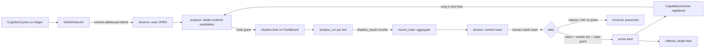

# Capability Genesis Loop

Status: **EXPERIMENT** (sandbox tier; no live case yet)  
Intent: `docs/intent/INTENT-0031-capability-genesis-loop.json`  
Deliberation: `docs/collaboration/deliberation-genesis-2026-10-13.json` (validator exit 0)  
Code: `egregore/genesis.py` over `egregore/parts.py`; tests `tests/unit/test_egregore_genesis.py`

## 1. Founder expression and compiled effect

Exact founder wording (2026-10-13) is preserved in INTENT-0031. In short: use the
mechanism foundry on build-your-own-x to make "a new digital developmental
substrate" for the Egregore; build it up to spider-web hegemony; maximize evidence,
institutional leverage, accountability, deterrence, victim protection and minimal
collateral harm; stay inside safety and legality; organize the work with the
collaboration protocol.

Compiled under INTENT-0030 (preserve the effect, not the metaphor):

| Founder phrase | Literal requirement kept | Compiled effect |
|---|---|---|
| "build your own x … do not clone tutorial products" | Mine the fork for primitives; build nothing that a tutorial already is | Seven primitives extracted and mutated (§3); no Git, DB, OS or container was rebuilt |
| "digital developmental substrate" | none (metaphor) | The shared state and lifecycle on which capability formation runs: deficit → candidates → trial → dossier → ratified binding → reusable genome |
| "anti-fragile, durable compounding asymmetric leverage" | none | Each formation leaves a genome and a rung-1 reuse path; failures become classified evidence; the loop gets cheaper per use |
| "maximize evidence" | yes | Content-addressed deficits and dossiers; trial samples; verifier tiers |
| "institutional leverage" | yes | Retained capabilities are portable genomes other organs can instantiate within envelope |
| "accountability" | yes | Every transition names an actor; bindings carry Gate receipts |
| "deterrence" | yes | Forged/replayed records are ignored; self-promotion impossible; doctrinal refusal blocks retain |
| "victim protection, minimal collateral harm" | yes | Required Guardian/Treasury cannot be emptied; shadows have no influence; rollback exists; stop is free |
| "impermeable shield … total systemic dominance" | none (metaphor) | Non-bypassability *inside* UNIIMENTE: no part changes without the Gate. Dominance over people or markets is not a goal and is not claimed |
| "spider-web hegemony" | the method | Applied to the internal formation transaction (§6). Market-level hegemony needs a governing external transaction that does not exist yet: **Stage-gate** |

## 2. The invention

**Name.** Capability Genesis Loop.  
**Identity.** A governed case lifecycle that turns standing cognition's own recorded
failures into ladder-ordered, shadow-trialled, human-ratified capability changes whose
outcomes become reusable genomes.

**Why it is different from what existed.** The parts board (PR #129) lets a human swap
a part. The evolution loop runs market-shaped improvement cycles. The genome registry
stores capabilities. None of them is triggered by the Egregore's own evidence, none
enforces that cheaper real mechanisms were considered first, and none turns a retained
change into the cheapest candidate for the next deficit. The loop does only that
connecting work and adds no authority.

**Emergent capability.** A new state the institution can maintain: an open, evidence-
bearing *formation case* with an admissibility record, a growing trial dossier whose hash
is what a human approves, and a terminal outcome that feeds the next case. No source
mechanism maintains that state alone.

## 3. Source mechanisms and mutations (build-your-own-x as atlas)

| Build-your-own-x category | Primitive extracted | Mutation applied | New behavior |
|---|---|---|---|
| Git | content addressing of objects | *object substitution*: the addressed object is a **deficit claim** and a **dossier**, not a file tree | Two identical failure patterns are one case; a dossier can be approved only as read |
| Database (write-ahead log) | replay to rebuild state | *authority mutation*: replay applies a "retained" label only when the authorized binding it names exists | Forged or replayed decision records are history, never state |
| Operating system | capability tokens | *moment relocation*: the token (Gate grant) is required at shadow and bind, never at observe/propose/stop | Stopping and observing are free; changing behavior is not |
| Distributed systems (quorum) | threshold agreement | *object substitution*: quorum becomes **verifier tier**; hypothesis-only tiers cannot retain | A model's opinion of a model cannot promote a model |
| Emulator / VM | run the same input on two machines | *information mutation*: shadow output is recorded, compared and never selected | Trial without influence |
| Package manager | dependency resolution order | *incentive mutation*: candidates are admissible only in resourcefulness-ladder order; `new_architecture` last | The anti-literalization gate becomes executable |
| Immune system (biology, via developmental research) | detect → contain → learn | *dynamic mutation*: failures in trial become classified learning artifacts (`evolution.failure_analysis`); `doctrinal_refusal` is lethal to the candidate | Never route around doctrine |

Each row changed incentives, authority or consequence, not only implementation.
Explaining the loop needs no repository names: deficits open cases; candidates enter in
cheapest-first order; shadows run without influence; a reviewed hash binds under a grant;
retained parts become genomes.

## 4. Topology

Feedback loops: (1) retained genome → cheaper next case; (2) failure classes → dossier
→ ratifier judgment; (3) recurrence count → case priority for humans.

## 5. Authority, incentives, failure

- **Authority.** Unchanged. Observe, propose, aggregate, regress, kill, close: no grant.
  Shadow and retain: `PartsBoard.change` through the Consequence Gate with a
  single-action grant bound to the slot's ledger head. The loop has no code path that
  binds without a grant (`tests/unit/test_egregore_genesis.py`).
- **Incentives.** Recording a cheaper rung as `searched_none` is free but attributed;
  the ratifier sees who said so (dissent recorded: this is self-reported). A candidate
  that fails in trial still produces a classified failure record, so failure is cheaper
  than concealment.
- **Failure and recovery.** Malformed ledger history is skipped on hydrate and kept as
  history. Parts whose code is not registered after restart are reported `resolved:
  false`, never guessed. Rollback uses the board's prior part. Terminal cases refuse
  further operations; a new deficit opens a new case.

## 6. Spider-web applied honestly

**Governing transaction (internal).** Alfonso must obtain a verified new or repaired
cognition capability, but completion is unreliable because fitness proof (shadow
evidence), eligibility (which mechanisms are admissible), routing (which slot) and
settlement (ratified binding) are not connected.

**Thesis.** Become the only path by which a standing-cognition part changes, by
controlling admissibility at proposal time, issuing a content-addressed dossier, and
tying it to a Gate-granted binding and a registered genome, while a bypass (editing code
by hand) cannot produce a receipt, a genome or a reusable rung-1 candidate.

**Four super-nodes.** Eligibility = ladder admission and slot match. Default routing =
slots and shadow-before-active. Proof/Truth = deficit ids, shadow_result records,
dossier hash, verifier tier. Settlement = Gate grant → binding record → genome.

**17-item checksum.** 1 bounded failure ✔ · 2 mandate-capable actor ✔ (Alfonso, internal
only) · 3 accepted artifact ✔ (dossier hash, accepted by the Gate path) · 4 downstream
consequence ✔ (binding changes cognition) · 5 eligibility ✔ · 6 default routing ✔ ·
7 proof→settlement ✔ · 8 NBOC trajectory **unresolved** (no live cases; natural
denominator = part changes; target 100 % through the loop) · 9 capital physics **n/a**
(zero fees; compute is real but unmeasured) · 10 incumbent self-harm **n/a** (no
external incumbent) · 11 four loops ✔ internal only · 12 governance/kill ✔ · 13 business
form ✔ (Tool inside an institution; not a market) · 14 intelligence flywheel **partial**
(failure classes and genomes; no live data) · 15 network effects **none claimed** ·
16 five-outcome **below gate**: Commercial 0, Strategic 3, Regenerative 3,
Institutional 4, Capital 0 · 17 capital continuity **n/a**.

**Decision: Stage-gate.** The internal control layer is complete and tested; nothing at
market level is claimed. The external wedge requires the founder to designate the first
venture cell's governing transaction (SR-INTENT-3 boundary). Until then, "hegemony" means
only: inside UNIIMENTE, no cognition part changes except through this proof-bound path.

## 7. Omnidirectional consequences (compressed)

| Perspective | Effect | Design response |
|---|---|---|
| Founder | Fewer hand edits; a dossier to read instead of code | Dossier is one JSON object with a hash |
| Future contributor | New vocabulary (cases, rungs) | One README table; states are the minimum for restart |
| Affected parties of Egregore proposals | Candidates cannot widen consequence class; evaluators cannot be emptied | Observed classes enter the genome envelope; `requires_human` for financial/irreversible |
| Hostile insider | Could forge records or false ladders | Forgeries ignored on hydrate; ladders attributed; retain needs grant + tier |
| Model vendor | Any local model is one `PartSpec` | Hosted models are not offered as parts (INTENT-20260930) |
| The system under degradation | Shadow server down → classified `transient`, not harm | Transient failures do not block retain; others do |
| Future descendant organs | Genomes are portable | `GenomeRegistry.may_instantiate` bounds them |

## 8. Adversarial analysis (what was attacked and what happened)

Each guard was deleted in turn; a test failed each time: cheaper-rung requirement,
`new_architecture` admission, doctrinal-refusal block, forged retained decision, dossier
integrity, minimum samples, foreign shadow results, hypothesis-only retain. Residual:
self-reported ladder outcomes (dissent recorded, owner named, trigger: first
`new_architecture` candidate).

## 9. Novelty boundary

- Known primitives: content addressing, WAL replay, capability tokens, canary/shadow,
  verifier tiers, package resolution order, failure classification.
- Known combinations: canary + rollback; feature flags + approvals.
- Mutated mechanisms: ladder-ordered admissibility as an executable anti-literalization
  gate; dossier-hash-bound ratification; replay-safe "retained" labels; failure classes
  as lethal-to-candidate evidence.
- Likely novelty: the interaction topology in which a cognition organ's own recorded
  failures open evidence-bearing formation cases that end in portable genomes, under an
  authority model where every behavior change needs a grant and every stop is free.
  Components are known; the mutated interaction appears structurally distinct from
  located precedents (feature-flag services, MLOps model registries, canary controllers,
  which do not bind admissibility to a resourcefulness ladder or decisions to a reviewed
  content hash). No patent or freedom-to-operate claim is made.

## 10. Evidence

| Claim | Tier | Reference | Finding |
|---|---|---|---|
| Loop retains only through a Gate-granted binding and registers a genome | unit test (real Gate, grants, passports, ledger; fake proposers) | `test_full_genesis_retains_binds_registers_genome_and_compounds` | pass |
| Guards are load-bearing | sandbox execution | mutation run 2026-10-13 (8 guards) | each removal fails a test |
| No kernel regression | unit tests | `python -m pytest` 2026-10-13 | 648 passed, 4 skipped, 2 failed; the 2 (`test_migration_spec_frozen`, `test_repair_spec_frozen`) fail identically on `main` in this shallow clone and passed in GitHub CI on the prior head |
| The loop achieves the founder's destination in reality | **none** | no live case | unproven |

## 11. Build path and kill test

1. **Now (this PR, draft):** code, tests, records. Decision EXPERIMENT.
2. **First live case (next):** run a real local model (`local_draft_part`) in shadow
   against a real deficit on real signals; aggregate ≥ 3 samples; founder ratifies with
   `qualified_human_review`. Measurable result: one case reaches RETAINED or REGRESSED
   with a dossier the founder actually read.
3. **Compounding check:** open a second deficit in the same slot; the retained part must
   appear as the rung-1 candidate; ticks-to-decision must fall.
4. **Kill test:** if a retained binding ever appears without a Gate receipt, or a forged
   record changes live state after restart, or the first live case shows the loop changed
   no decision a human would have made anyway, kill the loop and keep the record.

## 12. Final decisions

- Foundry: **EXPERIMENT**. Next action: first live shadow case. Measurable: one case
  reaches a terminal state with a read dossier. Evidence: ledger records + founder
  ratification. Stage gate: before any claim beyond sandbox. Termination: kill test above.
- Spider-web: **Stage-gate** (internal control complete; external wedge needs a founder
  decision on the first venture transaction).
- Collaboration protocol: **EXPERIMENT**; constitutional questions (external wedge,
  model evaluators, grant-free shadow detach) returned as NEEDS_FOUNDER_DECISION items in
  INTENT-0031 `unresolved_questions`.
